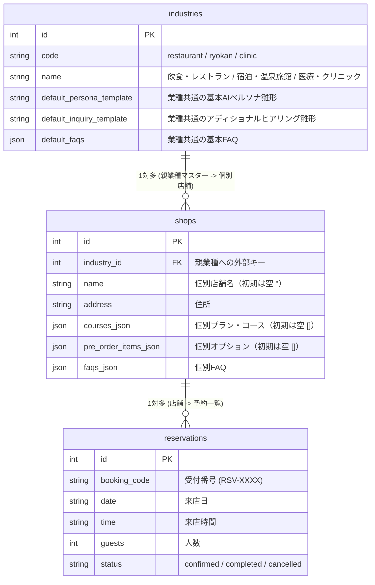

# VoiceReserve AI（音声型ダイレクト予約ボット）
> 問い合わせフォーム不要！電話感覚の音声対話 × リアルタイム予約カード同期システム  
> マルチ業態（飲食・温泉旅館・クリニック）対応の親業種リレーショナルアーキテクチャ

Web上の面倒な入力フォームや日程調整メールの往復を一切排除し、電話のように声で話しかけるだけで、空席・空室確認から予約確定・アディショナルヒアリングまでシームレスに完結するAI音声予約ボットです。

---

## 🌟 主な特長・コア機能

### 1. 人間特有の自然な会話への完全対応（全11ケース自動テスト済）
- **自己訂正・言い直し対応**: 「水曜14時…あ、違った木曜で！」「3名…いや、子供増えて4名で」などの訂正発話を検知し、直前の誤情報を破棄して最新情報を正確に反映。
- **FAQ質問の割り込みと自動復帰**: 「駐車場はある？」「個室って別料金かかる？」などの質問を途中で挟まれても、親切に回答した上で1つの発話内で予約手続きへ自動復帰。
- **お子様連れ・ベビーカー配慮**: 子供連れを検知すると危険なカウンター席を自動回避してテーブル席を確保。キッチン伝票に「子供用食器希望」「ベビーカーあり」を自動メモ。
- **混雑ピーク帯の2時間制事前合意**: 金土や18:00〜21:00のピーク時間帯の予約時、復唱確認の中で「2時間制のご了承」を必ずお客様と合意形成してから確定。
- **満席・個室満室時の代替提案**: 日時満席時は近傍の候補時間を提示。個室満室時は落ち着いたテーブル席（ボックス席）を代替提案。
- **記念日・誕生日サプライズ対応**: お祝いメッセージを添えたデザートプレートや特典の事前手配を提案。厨房伝票に紫色ハイライトで演出指示を表示。
- **既存予約の変更・キャンセル対応**: 重複した新規予約を作らず、既存予約の人数変更やキャンセルを即座に反映。

### 2. 業種（親）× 個別店舗（子）のリレーショナル設計
- **親テーブル (`industries`)**: 飲食（`restaurant`）、宿泊・温泉旅館（`ryokan`）、医療・クリニック（`clinic`）の業種特有の対話ルール・ペルソナ雛形・デフォルトFAQを保持。
- **子テーブル (`shops`)**: 初期は「空設定のテンプレ（`name: ""`、`pre_order_items: []`）」として生成。
- **コード改修ゼロで即導入**: 導入先の宿名やメニュー、オプション（竹崎カキ、竹崎蟹、貸切風呂など）をDBに1行流すだけで、即座にその施設専用のAI予約ボットが稼働します。

### 3. 店舗バックヤード（予約台帳 ＆ 厨房・ホール即応伝票）
- **🍳 厨房・ホール即応伝票ビュー**:
  - 来店と同時に乾杯が出せるよう、アレルギー警告と事前注文品（ファーストオーダー）を最優先表示。
  - **キャンセル分は即座に完全除外**: 誤調理や誤案内を防ぐため、キャンセルされた予約は伝票ビューから自動的に削除（非表示）されます。
- **📋 一覧テーブルビュー**:
  - 有効な予約のみをカウント・表示。必要に応じて「キャンセル済み予約も含めて表示」トグルで監査・確認が可能。

### 4. ゼロネイティブ開発（Kotlin / Swift 不要）
- モバイルアプリ（App Store / Google Play 審査）不要。
- スマートフォンのブラウザ（Safari / Chrome）でWeb Speech APIを通じてフル機能が動作するPWAライクなレスポンシブWeb UI。

---

## 🏗️ データベース設計（親業種 × 個別店舗リレーション）



---

## 🚀 クイックスタート

### 方法A: Docker Compose で起動（推奨 🐳）

```bash
cd voice-reserve-ai
docker compose up --build -d
```

- **音声予約画面**: `http://localhost:3001`
- **店舗管理・厨房伝票画面**: `http://localhost:3001`（画面右上のタブから切替）
- **バックエンドSwagger API**: `http://localhost:8001/docs`

> **業態の切り替え**: `.env` ファイルに `SHOP_PRESET=ryokan` や `SHOP_PRESET=clinic` を指定して `docker compose up -d` するだけで業態テンプレートを切り替え可能です。

---

### 方法B: ローカル環境で起動

#### 1. バックエンド (ポート 8001)
```powershell
cd voice-reserve-ai\backend
.\.venv\Scripts\Activate.ps1
$env:PYTHONPATH="."
uvicorn app.main:app --reload --port 8001
```

#### 2. フロントエンド (ポート 3001)
```powershell
cd voice-reserve-ai\frontend
npm run dev
```

---

## 🛠️ 店舗・施設情報の登録（API経由）

`PUT /api/shop` を叩くことで、DB内の店舗情報・別注オプション・プランを自由に更新できます。

```bash
curl -X PUT http://localhost:8001/api/shop \
  -H "Content-Type: application/json" \
  -d '{
    "name": "嬉野温泉 翠月楼",
    "industry_type": "ryokan",
    "pre_order_items": [
      {"id": "opt_oyster", "name": "炭火焼き竹崎カキ盛り合わせ", "price": 3500},
      {"id": "opt_crab", "name": "茹で上げ竹崎蟹", "price": 4800},
      {"id": "opt_bath", "name": "展望貸切露天風呂", "price": 2500}
    ]
  }'
```

---

## 🧪 テスト実行

全11件の対話コーナーケース・スロット抽出・リレーション検証テストを完備しています。

```powershell
cd voice-reserve-ai\backend
$env:PYTHONPATH="."
.\.venv\Scripts\pytest.exe tests/ -v
```

```text
tests/test_corner_cases.py::test_full_slot_alternative_proposal PASSED
tests/test_corner_cases.py::test_self_correction_speech PASSED
tests/test_corner_cases.py::test_faq_interruption_and_resumption PASSED
tests/test_corner_cases.py::test_children_and_stroller_handling PASSED
tests/test_corner_cases.py::test_peak_hours_two_hour_rule_agreement PASSED
tests/test_corner_cases.py::test_private_room_alternative_table_proposal PASSED
tests/test_corner_cases.py::test_anniversary_birthday_plate_support PASSED
tests/test_corner_cases.py::test_existing_reservation_modification_and_cancellation PASSED
tests/test_corner_cases.py::test_dynamic_industry_presets_ryokan_and_dental PASSED
tests/test_voice_reserve.py::test_dialogue_slot_extraction PASSED
tests/test_voice_reserve.py::test_booking_persistence PASSED

============================= 11 passed in 1.81s ==============================
```

